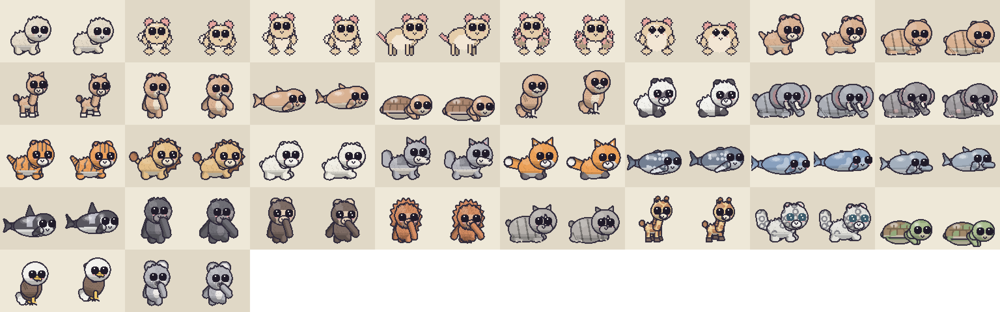

# Formiga Farm

Formiga Farm is a small, optional companion to Formiga Desktop. Desktop is where the creatures
live around you; Formiga Hill is where you go somewhere with them; Formiga Home is where you
step inside their houses. Farm is where you make them: a friendly workshop for drawing a new
Formiga, reshaping one that already lives in your colony, and keeping looks you like to start
from again.

The window is an editor laid over an ant farm: a glass habitat in a wooden frame, cut through
its soil, with tunnels and seed stores and a few tiny ants going about their business behind
everything. The ant farm is only scenery. The work happens on the stage in the middle, where the
creature stands large and alive while you change it.



## What it offers

- **Real body plans, not paint jobs.** Besides Desktop's five companion bodies there are seven
  sculpted ones: compact, large and tall four-legged bodies, an upright body with arms, a floater,
  a crawler and a percher. A whale hovers and bobs rather than walking on legs it does not have;
  a turtle paddles; an eagle hops.
- **Twenty-one animals to start from.** A giant panda, a red fox, both elephants, a tiger, a lion, a polar bear,
  a gray wolf, a humpback whale, a blue whale, a dolphin, an orca, a gorilla, a chimpanzee, an
  orangutan, a rhinoceros, a giraffe, a snow leopard, a sea turtle, a bald eagle and a koala,
  each a Formiga's idea of the animal. They are only starting points: a panda can grow horns, a
  whale can wear stripes. No animal carries a trait, a rarity or an advantage.
- **Drawn finer than a companion.** Farm draws its sculpted creatures at twice the detail of
  Desktop's companions, in the same pixel style: crisp edges and the same outline, with finer
  shading, fur, feathers and faces. "Desktop's pixels" under the stage shows a design exactly
  as a companion-sized frame would be.
- **From a picture.** Choose a picture (PNG, JPEG, WebP or GIF), or drop one on the window, and
  Farm reads it onto its own bodies: which body it is built like, its proportions and parts, its
  coat and belly colours, and its stripes, spots, patches, socks or eye patches. It offers a few
  takes to start from, never the picture itself, and keeps the face you already had. A picture
  is read on your computer and nothing of it is kept.
- **Four layers to work in.** *Form* (the body and its proportions), *Parts* (ears, snout, horns,
  tusks, mane, tail, feet, fins, back, wings and shell, each sized, tilted and coloured), *Finish*
  (the coat, its colours and up to four markings) and *Face* (one of Formiga's twelve face
  layouts, and the eyes, brows, mouth and cheeks). Parts, face layouts and the ways a marking can
  be laid out are chosen by picture, each showing the design as it would look. Every layer can be rolled at random on its own
  or put back as it started, and **Roll everything** rolls a new body and every layer at once,
  keeping whichever of them you tick.
- **Colours to start from.** Every colour has swatches beside it: the design's own colours and
  those of your palettes. Under *Finish*, any animal's colours, or a palette you kept, can be put
  on the design in one go, and the colours you have can be kept as a palette of your own.
- **Seen as it will live.** The strip under the stage plays it idle, moving, reacting,
  inspecting, resting, celebrating, being social and being held, facing either way, with every
  one of its expressions. It also shows it at its own size on a desktop, on a floor in Formiga
  Home, and out on the grass of Formiga Hill. Before and after is one key away. A companion
  that wears something in Desktop wears it on the new form too, placed as Desktop will place it.
- **Nothing lost.** Every change can be undone. Drafts are kept as you work and come back after
  Farm closes, even after a crash. The drafts shelf holds 64; when it is full it says so before
  the next new draft lets the oldest go, and names the one it let go. Looks you like can be kept
  on your own shelf as presets, which are never let go. Every draft and preset has a menu (its
  … button, or a right-click) to compare it side by side with the workbench, rename it,
  duplicate it, keep a draft as a preset, or copy its design code.
- **Said before, not after.** Notes under the stage say whether Desktop can keep a design,
  whether the creature is home to be changed, whether its eyes still show against its face, and
  what has been set aside because the new body has nowhere for it.

### What Farm does not do

Farm only ever changes how a creature looks. A Formiga that comes back from Farm is the same
individual with a new body: the same name, temperament, family, habits, friendships and history.
Farm never reads or writes the colony's save file. It hands Desktop a design, and Desktop checks
it and keeps it or not. If the creature changed in Desktop while you worked, Desktop says so and
nothing is overwritten; if Farm crashes, the creature simply keeps the look it had. A new Formiga
is only a design until you adopt it in Desktop's studio and give it a name there.

Formiga Hill and Home draw a creature from what Desktop sends on a trip, and a trip leaves a
sculpted body behind: there, a creature with one visits as the companion body nearest its own,
in its colours. Farm's Home and Hill previews show it exactly that way, and say so.

## Getting Farm

1. Farm's downloads are published on this repository's
   [Releases page](https://github.com/Von-Van/Formiga-Farm/releases) when a version is released;
   Farm is not on formigaworld.com yet. On macOS 14 or later there is a universal app, as a disk
   image or a zip. On Windows 10 or 11 there is a per-user installer, which puts Farm where
   Formiga Desktop looks for it, or a portable zip, which runs without installing but which
   Desktop does not look for. Each download has a `.sha256` checksum beside it.
2. On macOS, drag Formiga Farm into Applications. On Windows, run the installer.
3. In Formiga Desktop (0.67.6 or later), open a companion's page in the notebook and choose
   "Reshape in Formiga Farm", or open the studio and choose "Draw one in Formiga Farm". Desktop
   finds Farm on its own once it is installed.

The downloads are not signed yet. On macOS, open the app the first time with Control-click → Open;
on Windows, SmartScreen may ask before it runs.

Opened on its own, rather than from Desktop, Farm rehearses with Desktop's sample colony, and
nothing you apply there leaves its window.

The agreement between the two apps is written up in [docs/CONTRACT.md](docs/CONTRACT.md).

## Where things stand

Farm is a preview. Formiga Desktop 0.67.6 opens it from a companion's notebook page or the
studio. Opened on its own, Farm runs in **rehearsal**: it opens Desktop's own sample colony, or a real colony file read-only, and plays
Desktop's part with the contract's own rules, so a rehearsal proves the same loop a real session
would. What a rehearsal keeps lasts as long as the window.

| Part | Status |
| --- | --- |
| The design model, the drawing of sculpted forms and the design contract | Desktop's own (`formiga_core::forms`, `formiga_art::forms`, `formiga-farm-contract`), taken from Formiga Desktop 0.67.14 |
| Seven sculpted body plans, every Desktop clip on each | Preview |
| Twenty-one animal presets, seven body forms, Desktop's five companion bodies | Preview |
| The editor: four layers, undo, layer rolls and resets, before and after | Preview |
| Finer drawing of sculpted forms, starting from a picture | Preview |
| Drafts, personal presets, crash recovery | Preview |
| Previews on the desktop, in Home and on the Hill | Preview |
| Opening Farm from Desktop's notebook and studio | Formiga Desktop 0.67.6 |
| Packaging for macOS | A universal `Formiga Farm.app` with the bundle id and Farm version Desktop looks for, a zip and a disk image, each with its checksum. Built on GitHub's macOS machines for every packaging change; not yet released |
| Packaging for Windows | A per-user installer that writes the registry values Desktop reads, and a portable zip, each with its checksum. Built on GitHub's Windows machines for every packaging change; not yet released |

## Running it

```bash
cargo run --release -p formiga-farm
```

That rehearses drawing a new Formiga for Desktop's sample colony. Other ways in:

```bash
cargo run --release -p formiga-farm -- --sample-edit 0
```

```bash
cargo run --release -p formiga-farm -- --from-save "path/to/colony.json" --creature 0
```

`--preset animal.giant_panda` opens on a preset, and `--picture cat.png` opens reading a
picture. `--help` lists everything, including the review pictures drawn without a window
(`--render-presets`, `--render-poses`, `--render-habitat`, and `--import` for what a picture is
read as). `--pixels` draws the presets and poses at Desktop's companion size instead. The picture at the top
of this page is `--render-presets docs/assets/presets.png`.

Keys: ⌘Z or Ctrl+Z undoes and adding Shift redoes; ⌘S or Ctrl+S keeps the draft; B shows before
and after; F turns round; 1 to 8 choose a pose. Tab moves between controls, shelf entries included, and Enter
or Space picks the one focused; each shelf entry tells a screen reader its name. Opened on its
own, Farm has a Text size menu; with Desktop, text follows Desktop's setting.

### What Farm keeps on your computer

Farm's data folder is:

- macOS: `~/Library/Application Support/com.Formiga.Formiga-Farm`
- Windows: `%APPDATA%\Formiga\Formiga Farm\data`
- or wherever `FORMIGA_FARM_DATA_DIR` points.

| File | What it holds |
| --- | --- |
| `drafts/*.json` | Designs being worked on, each kept whole as you go |
| `presets/*.json` | Your own presets |
| `palettes/*.json` | Your own palettes: colours only |
| `window.json` | Where the window was |
| `open.lock` | Held while a window is open |

A file that cannot be read is set aside under another name, never deleted, and Farm opens without
it. Deleting a draft or preset never changes anyone in the colony.

## Building

Rust 1.97.1. The shared crates come from Formiga Desktop by one release tag, `v0.67.14`. The gate
CI runs on macOS and Windows:

```bash
cargo fmt --all --check && cargo clippy --workspace --all-targets -- -D warnings && cargo test --workspace
```

### Packaging

- **macOS.** `scripts/package-macos.sh` builds a universal `Formiga Farm.app`, with the bundle id
  and Farm version Desktop looks for, plus a zip and a disk image beside it in `dist/`.
- **Windows.** `scripts/package-windows.ps1` builds a portable zip and a per-user installer that
  writes the registry values Desktop reads. The installer needs the WiX 4 command-line tool.

Both scripts ask the built binary for the Farm version it reads (`--farm-version`) and for its
icon (`--icon <folder>`), so a package can never claim a version it does not read. Pushing a `v*`
tag runs both on GitHub's own macOS and Windows machines and publishes a release with every
package and its checksum, its notes taken from that version's section of
[CHANGELOG.md](CHANGELOG.md); a pull request that changes the packaging builds every package the
same way without publishing anything. Both sign when `FORMIGA_CODESIGN_IDENTITY` (and
`FORMIGA_NOTARY_PROFILE`) or `FORMIGA_SIGNTOOL_CERT_SHA1` is set, and otherwise ship unsigned.
`scripts/set-version.sh <version> [<desktop tag>]` writes a new version, or a new Desktop tag,
everywhere it is named; `--check` says whether every place agrees.

## License

MIT. See [LICENSE](LICENSE). Formiga Farm is a personal project and does not take outside pull
requests, but forks are welcome: [CONTRIBUTING.md](CONTRIBUTING.md) says how to make your own.
